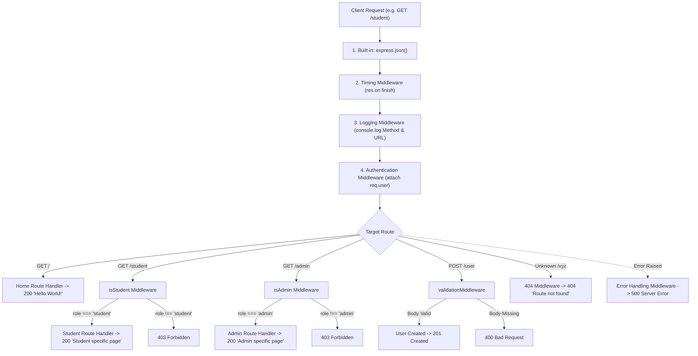

# Lab Practical: Implementation of Middleware in Express.js

## 1. Title
**Implementation and Execution of Middleware in Node.js using Express.js**

---

## 2. Aim
To create a Node.js application using Express.js and implement different types of middleware such as:
- Built-in middleware (`express.json()`, `express.urlencoded()`)
- Application-level middleware (`app.use()`)
- Logging middleware (HTTP method, URL, and timestamp)
- Timing middleware (response duration measurement in milliseconds)
- Authentication middleware (verifies user identity and sets `req.user`)
- Validation middleware (validates incoming payload structure)
- Role-based authorization middleware (`isStudent`, `isAdmin`)
- Route-specific middleware
- 404 Not Found handling middleware
- Centralized Error handling middleware (`err, req, res, next`)

The practical also demonstrates how the `next()` function controls the flow of execution between middleware functions and prevents execution halt or response header errors.

---

## 3. Architecture & Request Flow



---

## 4. Key Middleware Categories Implemented

| Middleware Type | Implementation | Purpose |
| :--- | :--- | :--- |
| **Built-in** | `app.use(express.json())` | Parses incoming JSON payloads and attaches to `req.body` |
| **Application-level** | `app.use(loggingMiddleware)` | Runs globally for every incoming request across all HTTP methods |
| **Performance/Timing** | `res.on('finish', ...)` | Tracks request processing time in milliseconds |
| **Authentication** | `req.user = { userId: 1, name: "Gaurav", role: "student" }` | Identifies and validates user ("Who are you?") |
| **Authorization** | `isStudent`, `isAdmin` | Verifies route access permissions ("What are you allowed to do?") |
| **Validation** | Checks `req.body` presence | Prevents empty or malformed requests reaching business logic |
| **Route-specific** | `app.get('/student', isStudent, ...)` | Attaches middleware only to designated endpoints |
| **404 Catch-All** | `app.use((req, res) => ...)` | Returns standard 404 JSON for non-existent paths |
| **Error-handling** | `app.use((err, req, res, next) => ...)` | Catches uncaught runtime errors and returns 500 status |

---

## 5. Important Concepts & Rules

### Difference Between Authentication & Authorization
- **Authentication**: Answers **"Who are you?"** (e.g., verifying credentials, JWT tokens, sessions). If invalid $\rightarrow$ `401 Unauthorized`.
- **Authorization**: Answers **"What are you allowed to access?"** (e.g., checking user role: student vs admin). If permission denied $\rightarrow$ `403 Forbidden`.

### The `next()` Golden Rule
- Call `next()` when you want the request to move to the subsequent middleware or route handler.
- Call `res.send()` or `res.json()` when you want to end the request cycle and return a response.
- **Never call `next()` after sending a response**: Doing so triggers Express error: `Cannot set headers after they are sent to the client`.

### Middleware Execution Order
Express executes middleware **sequentially** in the order they are registered with `app.use()` and route definitions. Placing logging or parsing middleware after route handlers causes them to be skipped for matching routes.

---

## 6. How to Run & Test

### Installation
```bash
npm install
```

### Start Server
```bash
npm start
# Server listens on port 3000
```

### Run Automated Test Suite
```bash
npm test
# Executes test.js covering 12 test assertions
```

---

## 7. Test Results Matrix

| Test # | Route / Method | Parameters / Body | Expected Status | Expected Output |
| :--- | :--- | :--- | :--- | :--- |
| **Test 1** | `GET /` | None | `200 OK` | `"Hello World!"` |
| **Test 2** | `GET /student` | Default (`role: "student"`) | `200 OK` | `"Student specific page"` |
| **Test 3** | `GET /admin` | Default (`role: "student"`) | `403 Forbidden` | `{"success": false, "message": "Access denied: this route is only for admins"}` |
| **Test 4** | `GET /admin` | Query `?role=admin` | `200 OK` | `"Admin specific page"` |
| **Test 5** | `GET /student` | Query `?role=admin` | `403 Forbidden` | `{"success": false, "message": "Access Denied, this route is only for students"}` |
| **Test 6** | `POST /user` | JSON `{ "name": "Gaurav", "course": "MBA" }` | `201 Created` | `{"success": true, "data": {...}}` |
| **Test 7** | `POST /user` | Empty Body `{}` | `400 Bad Request` | `{"success": false, "message": "Request body is missing"}` |
| **Test 8** | `GET /user/101` | URL Param `:id=101` | `200 OK` | `{"success": true, "id": "101"}` |
| **Test 9** | `GET /search?id=101` | Query Param `id=101` | `200 OK` | `{"success": true, "query": {"id": "101"}}` |
| **Test 10** | `GET /nonexistent` | Unknown URL | `404 Not Found` | `{"success": false, "message": "Route not found"}` |
| **Test 11** | `GET /trigger-error` | None | `500 Internal Server Error` | `{"success": false, "message": "Something went wrong on the server"}` |
| **Test 12** | `GET /?unauthenticated=true` | Simulates unauthenticated user | `401 Unauthorized` | `{"success": false, "message": "Not a valid User"}` |

---

## 8. Viva Questions & Answers

**Q1: What is middleware in Express.js?**  
*Answer:* Middleware functions are functions that have access to the request object (`req`), the response object (`res`), and the `next` function in the application's request-response cycle.

**Q2: What are the three standard parameters of a middleware function?**  
*Answer:* `req` (Request object), `res` (Response object), and `next` (Callback function to pass control to the next middleware).

**Q3: What is the purpose of `next()`?**  
*Answer:* `next()` passes control to the next matching middleware function or route handler in the stack. If not called, the request hangs.

**Q4: What happens if `next()` is omitted and no response is returned?**  
*Answer:* The client request hangs indefinitely until the client or browser times out.

**Q5: What is `express.json()`?**  
*Answer:* A built-in middleware based on `body-parser` that parses incoming requests with JSON payloads and populates `req.body`.

**Q6: What is the difference between Authentication and Authorization?**  
*Answer:* Authentication verifies the identity of the user ("Who are you?"), returning HTTP 401 if unauthenticated. Authorization verifies what resources or actions the authenticated user has access to ("What can you do?"), returning HTTP 403 if forbidden.

**Q7: What does HTTP Status Code 401 mean?**  
*Answer:* `401 Unauthorized` — Indicates that the request lacks valid authentication credentials for the target resource.

**Q8: What does HTTP Status Code 403 mean?**  
*Answer:* `403 Forbidden` — The server understands the request and authenticated identity, but refuses authorization.

**Q9: Why shouldn't `next()` be called after `res.send()`?**  
*Answer:* Once a response is sent to the client, calling `next()` may trigger downstream handlers to attempt sending another response, resulting in `Error: Cannot set headers after they are sent to the client`.

**Q10: What is the signature of an Error-Handling middleware in Express?**  
*Answer:* It must take 4 parameters: `(err, req, res, next)`. Without all 4 parameters declared, Express will treat it as standard middleware.
